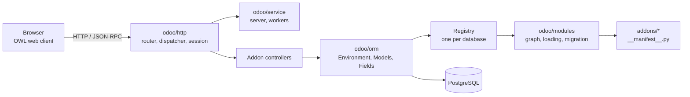
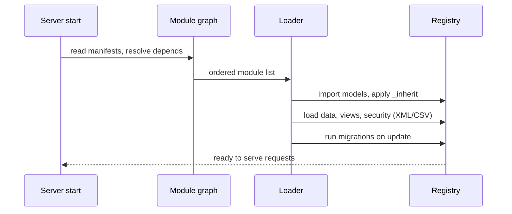

# Odoo 20.0 — Project Overview

## What it is

Odoo is a modular, open-source business suite (ERP/CRM). A small Python **framework** (`odoo/`)
loads **addons** (`addons/`, ~648 directories) that each contribute models, views, security
rules, data, controllers and web assets. Apps can be used alone or combined.

## Tech stack

| Layer | Technology (from repo files) |
|---|---|
| Language | Python (`requirements.txt` pins for 3.11 to 3.14) |
| Database | PostgreSQL via `psycopg2` (`odoo/sql_db.py`) |
| ORM | Custom, in `odoo/orm/` (models, fields, domains, registry, cache) |
| Web server | Werkzeug-based, `odoo/http/`; gevent for the long-polling/worker setup |
| Templating | QWeb (`ir_qweb`), Jinja2 for some tooling |
| Frontend | OWL components, `addons/web/static/src` |
| Reports | QWeb to PDF (`base_report_wkhtmltox`, `base_report_paper_muncher`) |
| Packaging | `setup/` (deb, rpm, docker, win32, IoT box builder) |

## Architecture



## Module loading

Each addon declares `depends` in `__manifest__.py`. `odoo/modules/module_graph.py` orders them,
`odoo/modules/loading.py` imports the Python code, loads data/views/security files and runs
migrations (`odoo/modules/migration.py`). The result is a **Registry** per database holding the
final model classes, built by combining base classes with `_inherit` extensions.



## Typical addon layout

```
my_module/
  __manifest__.py   # name, depends, data, assets
  models/           # ORM models
  views/            # XML views and menus
  security/         # ir.model.access.csv, record rules
  controllers/      # HTTP routes
  data/ demo/       # records loaded on install / demo
  wizard/           # transient models
  report/           # QWeb reports
  static/src/       # JS (OWL), SCSS, XML templates
  tests/            # Python tests
  i18n/             # translations
```

## Addon groups (by name pattern, counted from `addons/`)

| Group | Count | Notes |
|---|---|---|
| `l10n_*` localizations | 234 | Charts of accounts, taxes, e-invoicing per country |
| `website*` | 52 | Website builder and website apps |
| `pos_*` / `point_of_sale` | 47 | Point of Sale and its integrations |
| `payment*` | 24 | Payment providers |
| All others (excluding `l10n_`, `test_`, `theme_`) | 393 | Business apps and glue modules |
| `odoo/addons/` | 16 dirs | `base` plus `test_*` framework test modules |

## Core business apps (manifest facts)

| Module | Category | Depends on |
|---|---|---|
| `account` (Invoicing) | Accounting/Accounting | base_setup, onboarding, product, analytic, portal, digest |
| `sale` (Sales) | Sales/Sales | sales_team, account_payment, utm |
| `stock` (Inventory) | Supply Chain/Inventory | product, barcodes_gs1_nomenclature, digest |

## Notable repo extras

- `skills/` – Odoo's own agent skills: `odoo-git`, `odoo-guidelines`, `odoo-review`, `odoo-security`, `odoo-web-guidelines`. Read these before changing code.
- `odoo/cli/` – commands such as `server`, `shell`, `scaffold`, `db`, `module`, `i18n`, `neutralize`, `upgrade_code`.
- `odoo/upgrade` and `odoo/upgrade_code` – upgrade scripts and code-upgrade tooling.
